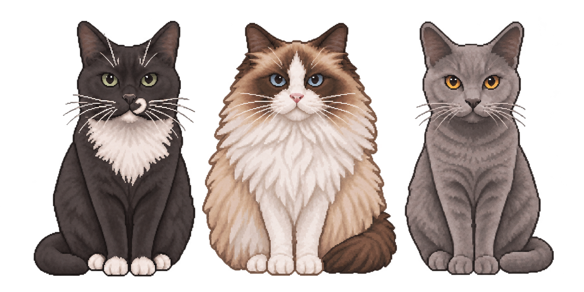

# 伊二三万

免安装的 Windows 像素风桌宠。三只猫并排坐着，一起移动、缩放，并随选定音乐播放器的声音点头摇摆。



## 下载与运行

前往 [Releases](https://github.com/xJerzseyx/three-cats-desktop-pet/releases/latest) 下载绿色 ZIP，解压后按包内使用说明运行。

适用 Windows 10 / 11 的 64 位系统，使用 Windows 自带的 .NET Framework 4.x。更新时先通过旧版托盘菜单退出，再运行新版。

## 功能与操作

- 默认整组宽度为 300 像素，对应 50% 大小。已有配置时使用保存的大小。
- 透明背景、无边框、置顶显示。
- 左键拖动整组，鼠标滚轮缩放。右键猫咪或托盘图标打开菜单。
- 无音乐时头部与瞳孔跟随光标。播放音乐时头部随音乐动作，瞳孔继续跟随。
- 托盘提供显示或隐藏、大小调整、音乐来源、移回主屏幕和退出。
- 可勾选“开机自启动”，默认关闭，取消勾选即可关闭。
- 位置、大小和播放器名单保存在 EXE 旁的 XML 文件中。

## 音乐来源

默认选择网易云音乐 `cloudmusic.exe` 和 QQ 音乐 `qqmusic.exe`。本地播放器通过“音乐来源设置”选择 EXE，或从音频程序列表中添加。

程序读取各播放器音频会话的峰值，用声音强弱变化驱动同步点头和摇摆。来源筛选按进程进行，选定播放器中的广告和语音同样会触发动作。持续安静约半秒后恢复头部鼠标跟随。

完整操作与自启动路径更新方法见 [中文使用说明](USAGE.zh-CN.txt)。

## 从源码构建

在 64 位 Windows 的 PowerShell 中运行以下命令。

```powershell
.\build.ps1
```

构建使用系统目录中的 .NET Framework C# 编译器，生成 `artifacts/伊二三万.exe`。最终猫咪 PNG 作为资源内嵌在 EXE 中。

## 运行测试

```powershell
.\tests\run.ps1
```

音频集成测试需要可用的 Windows 音频输出设备，会短暂播放低音量测试音，并打开、关闭测试用桌宠窗口。

自启动读写测试通过以下命令单独启用。它在当前用户的独立临时注册表测试键中执行，结束后清理该键。

```powershell
.\tests\run.ps1 -IncludeStartup
```

## 验证范围

已在 Windows 10 22H2 x64、内部版本 19045 上通过 17 项逻辑测试、24 项集成检查和 6 项临时注册表测试。已检查瞳孔在音乐期间的鼠标跟随、头部音乐动作、默认大小、托盘菜单、配置保存及并发音源筛选。

Windows 11、真实网易云和 QQ 音乐客户端、注销后重新登录的实际自启动尚未逐一实机验证。多显示器实际切换和 DPI 切换也待实机验证。置顶显示受 Windows 窗口层级限制，独占全屏和系统安全桌面由系统控制。

## 许可证

采用 [MIT License](LICENSE)。
